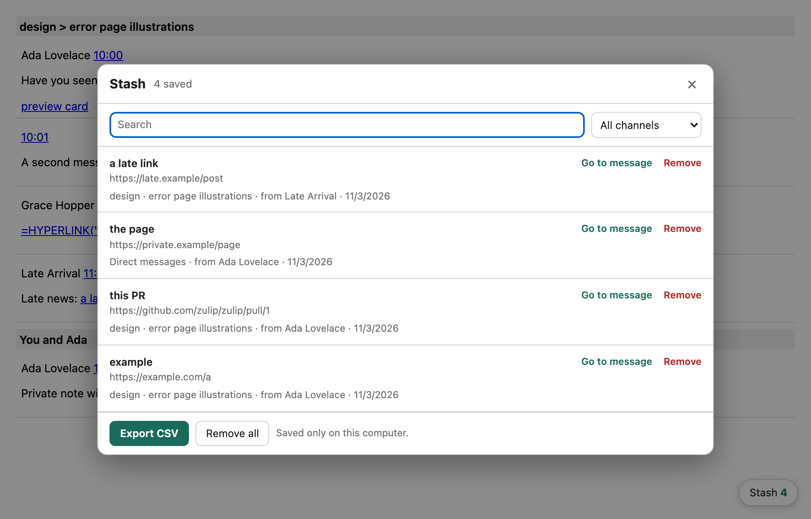

# Zulip Stash

Save the links you want to keep from Zulip, inside the Zulip Mac app. They go into a list that you can search and export as a CSV.



<sub>Screenshot of the test page in `tests/fixture.html`, with made-up messages.</sub>

- A small **+** appears next to every link in a message. Click it to save that link.
- A **Stash** button in the bottom-right corner opens your saved list. Search it, filter it by channel, jump back to the message a link came from, remove links, or press **Export CSV**.
- Every saved link remembers its channel, topic, who wrote it, and a link back to the message.

It was made for Recurse Center's Zulip, and works on any Zulip server in the app.

## How it works

The Zulip app can't load browser extensions, so this comes in three small pieces:

- **`core.js`**: the script that runs inside the Zulip page and adds the buttons and the Stash window.
- **`zulip-stash-launcher.mjs`**: opens the Zulip app and loads `core.js` into it.
- **`install.sh`**: builds a **Zulip Stash** app in your Applications folder, which runs the launcher. You open it instead of Zulip.

In more detail:

1. Zulip Stash.app starts the launcher.
2. The launcher opens Zulip with a debugging port (`--remote-debugging-port`, a standard switch for apps built with Electron, as Zulip is). The port is random, only listens on `127.0.0.1`, and only exists while Zulip was started this way.
3. It connects to that port and tells every Zulip page to run `core.js`, now and after every reload.
4. When you quit Zulip, the launcher exits. Opening Zulip the normal way, from the Dock, gives you plain Zulip with no Stash.

## Install

You need a Mac with the Zulip app in `/Applications`, and [Node.js](https://nodejs.org) 22 or newer (`brew install node` works).

1. Download this project: click the green **Code** button on this page, then **Download ZIP**, and unzip it (or use `git clone`).
2. Open Terminal in that folder and run:

   ```
   ./install.sh                          # Stash on every server in your Zulip app
   ./install.sh recurse.zulipchat.com    # or only the servers you name
   ```

3. Open **Zulip Stash** from your Applications folder (in your home folder, `~/Applications`). If Zulip is already open, it quits Zulip and opens it again with Stash loaded. macOS may ask you to allow that the first time.
4. You should see **Stash 0** in the bottom-right corner of Zulip.

Put **Zulip Stash** in your Dock instead of Zulip. Run `./install.sh` again after you change any of the files.

## What it does with your data

Your list is kept in the Zulip page's own storage (`localStorage`), which is part of the Zulip app's data on your Mac (`~/Library/Application Support/Zulip`). It never goes to a server, to me, or to anyone else. Stash makes no network requests and doesn't use Zulip's API. It only reads the page you already have open, and it only saves something when you click.
